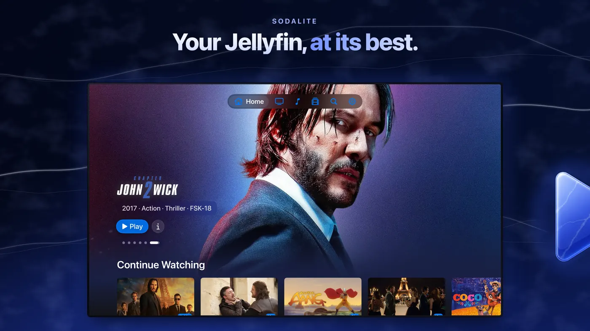
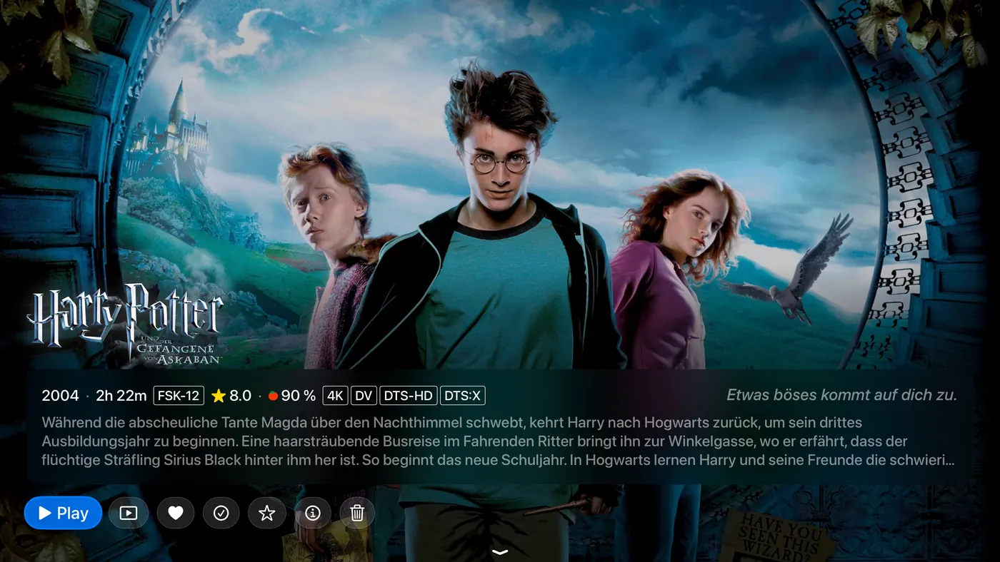
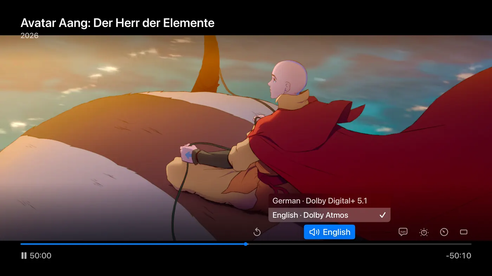
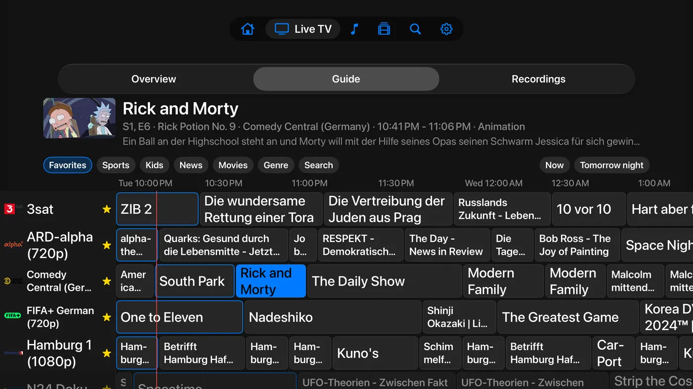
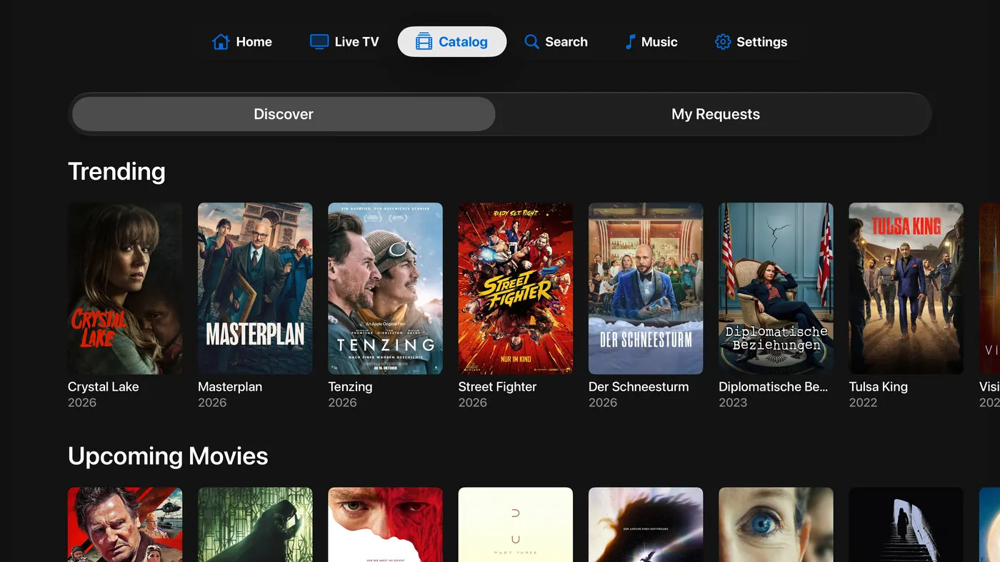
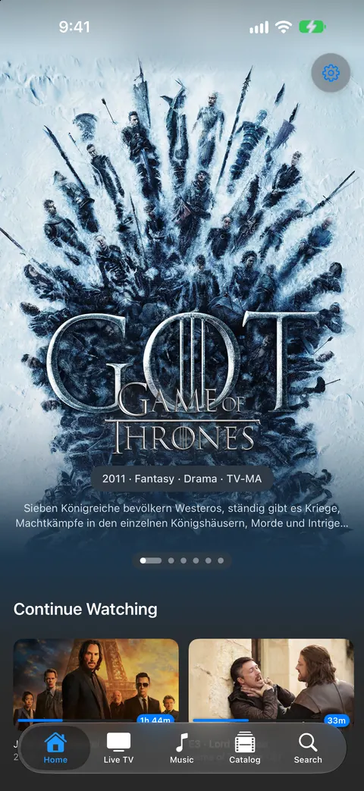
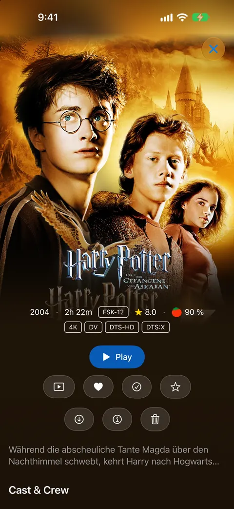
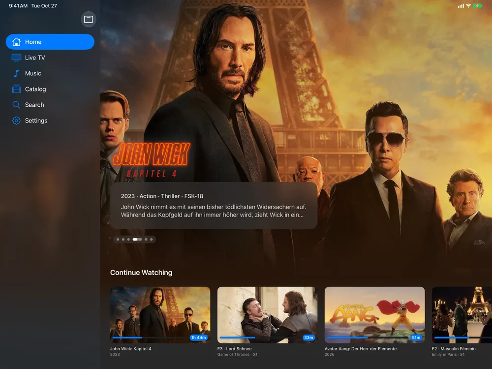
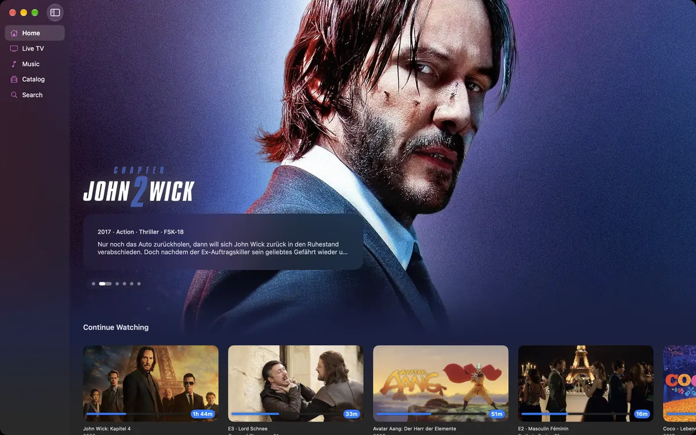

<p align="center">
  
</p>

<h1 align="center">Sodalite</h1>

<p align="center">
  <b>Your Jellyfin library and Seerr, together on every Apple screen.</b><br>
  A free, native app for Apple TV, iPhone, iPad and Mac.<br>
  Instant playback, real HDR, Dolby Atmos and lossless height channels.
</p>

<p align="center">
  <a href="https://apps.apple.com/app/sodalite/id6764418563"></a>
</p>

<p align="center">
  <a href="https://sodalite.superuser404.de">Website</a> ·
  <a href="https://testflight.apple.com/join/nWeQzmBX">TestFlight beta</a> ·
  <a href="https://github.com/superuser404notfound/Sodalite/issues/new/choose">Report a bug</a> ·
  <a href="https://discord.gg/P7NvpzNqnG">Discord</a>
</p>

<p align="center">
  
  
  
  
  
  <a href="https://ko-fi.com/superuser404"></a>
</p>

<p align="center">
  
</p>

## What it is

Sodalite plays your [Jellyfin](https://jellyfin.org) library on Apple TV, iPhone, iPad and Mac. It is one universal app: the same library, the same player and the same settings on every device.

It plays your files directly, in the quality they were made in, so your server rarely has to convert anything. And it has [Seerr](https://github.com/seerr-team/seerr) built in: when something is missing, you request it from inside the app.

## Screenshots

<table>
  <tr>
    <td width="50%"></td>
    <td width="50%"></td>
  </tr>
  <tr>
    <td align="center">Detail page (Apple TV)</td>
    <td align="center">Player (Apple TV)</td>
  </tr>
  <tr>
    <td></td>
    <td></td>
  </tr>
  <tr>
    <td align="center">Live TV guide (Apple TV)</td>
    <td align="center">Seerr catalog (Apple TV)</td>
  </tr>
</table>

<table>
  <tr>
    <td width="14%"></td>
    <td width="14%"></td>
    <td width="36%"></td>
    <td width="36%"></td>
  </tr>
  <tr>
    <td align="center">iPhone</td>
    <td align="center">iPhone</td>
    <td align="center">iPad</td>
    <td align="center">Mac</td>
  </tr>
</table>

## Install

Get Sodalite free from the **[App Store](https://apps.apple.com/app/sodalite/id6764418563)**. One download covers Apple TV, iPhone, iPad and Mac. To try new versions before they ship, join the [public TestFlight beta](https://testflight.apple.com/join/nWeQzmBX) (see [BETA.md](BETA.md)).

| Device | Needs |
| --- | --- |
| Apple TV | Apple TV 4K (any generation), tvOS 26 |
| iPhone / iPad | iOS 26 / iPadOS 26 |
| Mac | macOS 26 |
| Jellyfin server | 10.9 or later recommended |
| Seerr (optional) | 2.0 or later |

An Apple TV HD runs the app too, but 4K HDR needs the 4K model. iPhone and iPad show HDR on their own screen.

## What runs where

Almost everything works on every device. A few things are specific to one platform:

| | Apple TV | iPhone & iPad | Mac |
|---|:---:|:---:|:---:|
| Library, Direct Play, HDR, subtitles | ✓ | ✓ | ✓ |
| Seerr requests, Trakt, Live TV, music | ✓ | ✓ | ✓ |
| Watch Stats, parental controls, 26 languages | ✓ | ✓ | ✓ |
| Picture in Picture | ✓ | ✓ | ✓ |
| Dolby Vision | ✓ | ✓ | |
| Multiview, Top Shelf, profiles per Apple TV user | ✓ | | |
| Offline downloads, AirPlay, HDMI adapter out | | ✓ | |
| Rotation lock, child lock, portrait player | | ✓ | |

The Mac app is native (SwiftUI on AppKit, not Catalyst): a sidebar, pages with a back button and Cmd-[, the player in its own window with keyboard control and full screen, Settings under Cmd-, and right-click menus. Live TV shows a channel list instead of the guide grid, and styled ASS/SSA subtitles show as plain text.

## Features

Every feature is free. Settings are named as they appear in the app.

### Browse and discover

- **Finds your server**: Jellyfin on your network is found automatically, or you type the address.
- **Several servers**: keep more than one Jellyfin server and switch without logging out (Settings → Servers).
- **One Home for all servers**: turn on Combine servers and Home merges up to five servers into one. Continue Watching becomes one timeline, a film on two servers shows once, and a server that does not answer drops out quietly. Search, genres, streaming services, Live TV, Music and the Apple TV Top Shelf work across all of them.
- **Local and remote address**: give a server a local and a remote URL. Sodalite uses whichever one answers, so it also works over a VPN. Editable on iPhone and iPad for Jellyfin and Seerr, with a badge for the active route.
- **Home rows**: Continue Watching, Next Up, Latest Movies, Latest Shows and My Media. Turn every row on or off, change the order, merge Continue Watching and Next Up, add a Latest row per library, and give any row a name of your own.
- **Recently Released**: two optional rows that sort by release date instead of by when a title reached your server.
- **Upcoming**: an optional row with the next episode of every show you are caught up on, and when it airs. Needs a metadata plugin that lists unaired episodes; Seerr fills in the rest.
- **Arrange My Media**: Customize Home sets the order of your libraries and hides the ones you do not need, also across combined servers.
- **Libraries**: Movies, Series and Collections as poster grids, with an All / Unwatched / Watched filter. Sort by title, release date, date added, rating or runtime; the sort is remembered per library and synced. Movies can be grouped into collections, following your server's setting or your own.
- **Home videos**: a Home Videos library opens as folders, and Shuffle plays everything below the folder you are in.
- **Series**: season picker, episode list and Up Next highlight.
- **Collections and playlists**: open on their list of films and play in order, starting at the first one you have not finished. Large collections open as a grid with a Movies / Shows filter. Each collection library and your playlists can get their own Home row.
- **Search**: across your whole server, results as you type. With Seerr, actors and directors come back as people with photo, biography and filmography.
- **Detail pages**: the first screen is artwork, with three lines of the plot, year, runtime, ratings and format badges. The info button shows the full plot plus every audio and subtitle track, and the bottom line names the file, size, codecs and bitrate. Further down: cast, director, writer, studios, and similar titles (what you have, and with Seerr what you could request).
- **Named ratings**: with Seerr connected, the ratings say where they come from: TMDB for movies and shows, IMDb for movies, and Rotten Tomatoes where your server has no critic score.
- **An honest Play button**: it names the episode it will start, shows the time left when you can resume, and says Play Again when you have finished.
- **Format badges**: the detail page shows what your copy really is: 4K, 1080p or 1080i for interlaced TV recordings, Dolby Vision, HDR10+, HDR10 or HLG, the audio codec, and Atmos or DTS:X. Optional badges on poster cards show the same at a glance (Settings → Appearance).
- **Spoiler protection**: optionally blur episode images and descriptions until you have started them. Each series can override it.
- **Title logos and full-bleed artwork**: title logos over the backdrop, full episode synopses, and a page that keeps text readable as you scroll. Both switchable in Appearance.
- **Watched status**: mark movies, episodes, seasons or whole series as watched or unwatched. Part-watched cards show the time left.
- **Favorites**: heart movies, series, collections or single episodes. Favorite episodes get their own Home row.
- **Your own rating**: rate a movie, show or episode from 1 to 10. Sodalite can ask when a film ends. The rating is stored in Jellyfin, so other tools can read it, and an optional star shows it on cards.
- **Cast and filmography**: open anyone in the cast to see their photo, biography and filmography. What you own comes first, and an episode they guest in opens right at that episode.
- **Delete from the app**: remove movies, series or seasons from your server, and optionally the matching Radarr / Sonarr entries through Seerr.
- **Fast images**: posters and backdrops load before you reach them.

### Trakt

- **Built in, no server plugin**: connect Trakt in Settings → Trakt with a code you enter on your phone.
- **Scrobbling and sync**: what you watch is scrobbled. Watched status syncs both ways and only ever adds (nothing is marked unwatched by a sync).
- **Ratings and resume points**: your ratings go to Trakt, Trakt ratings fill in what you have not rated, and a position you paused at in another Trakt app becomes your Continue Watching spot here.
- **Watchlist and lists as Home rows**: a title on your server opens its page; one that is missing opens in Seerr so you can request it.
- The connection belongs to one profile on one device. If your server runs the Jellyfin Trakt plugin, use only one of the two. Sodalite uses Trakt but is not endorsed or certified by Trakt.

### Watch

- **Direct Play for almost everything**: H.264, HEVC (including Main10), AV1, VP9, VP8, MPEG-4 Part 2 (XviD / DivX), MPEG-2, VC-1, old Microsoft formats (MS-MPEG4 v1 to v3, WMV1 to WMV3) and old Flash video (Sorenson Spark, On2 VP6). Containers: MKV, MP4, MOV, AVI, MPEG-TS, M2TS, VOB, 3GP, WebM, OGG, ASF / WMV and FLV, with their audio. Only rare codecs like Theora and RealVideo still go through the server.
- **Resume anywhere**: pick up where you left off, on any device. A Restart button plays from the start instead.
- **Pick your version**: when a title has several versions (rips, resolutions, editions), choose which one to play.
- **Shuffle a series**: random episodes across all seasons.
- **Trailers**: local trailers play from your server. On iPhone, iPad and Mac, a title without one plays its YouTube trailer instead.
- **Theme songs** (optional, Settings → Playback): a movie or show page plays its theme song from your server, fades in and out, and never starts over music from another app.
- **Skip Intro and Skip Recap**: one tap, using the markers your server detected. Recap auto-skip has its own setting.
- **Next episode**: plays automatically with a countdown of 5 to 30 seconds, or none. The countdown can sit on the credits or wait until the episode really ends. Without a countdown, credits and post-credit scenes play out first.
- **Picture in Picture**: from a player button on Apple TV, automatically when you swipe home on iPhone and iPad. Also works there for titles the software decoder plays.
- **iPhone Duo**: stand it half folded and the picture plays on the upper half, while the controls, the subtitles and, in live TV, the channel list stay on the lower half. Music shows the cover above and the queue below.
- **Streaming quality**: limit the bitrate when the connection is slow (Original, or 40 down to 2 Mbit/s). Files that already fit keep playing directly. Set a default (on iPhone and iPad separately for Wi-Fi and cellular) or change it in the player; it reopens at the same second.
- **Network buffer**: choose how far ahead Sodalite reads, from about 40 seconds up to Unlimited (as much as free space safely allows), so a flaky connection does not stop the picture.

### Picture and sound

- **HDR10, HDR10+, Dolby Vision and HLG**: detected automatically and played with their full metadata, including HDR10+ per-frame data. Apple TV switches your TV to the matching mode (Match Content); iPhone and iPad show it on their own screen.
- **Dolby Vision Profiles 5, 8.1 and 8.4**, and **Profile 7 too**: Blu-ray remuxes with Profile 7 are converted on the device to Profile 8.1, so your TV still shows Dolby Vision. A FEL title keeps the disc's own mapping and has its enhancement layer's brightness folded in scene by scene, which brings the picture much closer to the disc.
- **Dolby Vision on panels without it** (experimental, Settings → Playback): the Apple TV can apply the per-frame Dolby Vision data itself instead of sending the static HDR10 layer.
- **Dolby Atmos**: Dolby Atmos from Dolby Digital Plus tracks lights up your receiver's Atmos sign over Apple TV, and plays as spatial audio on iPhone and iPad where supported.
- **Lossless height channels from TrueHD and DTS:X**: Apple TV cannot pass TrueHD or DTS-HD to a receiver, so these tracks normally lose their height channels. Sodalite keeps them: the engine renders the track into a mix for your speaker layout (5.1.2, 5.1.4, 7.1.2, 7.1.4 or the default 9.1.6) and sends it over HDMI as 24-bit PCM, bit for bit (AirPods get Spatial Audio, AirPlay gets Apple Positional Audio). DTS:X IMAX tracks keep their heights too. A film that has such a track opens on it in your language. On by default; pick the layout your receiver drives, or Off, under Height Channels next to Prefer Lossless Audio in Settings → Playback. On a soundbar with legacy ARC, it plays as Dolby Digital Plus 5.1.
- **Enhanced Upscaling**: sharpens SD and 720p video with on-device machine learning. A player button turns it off and on for the video that is playing.
- **Surround**: 5.1 and 7.1 with the correct channel layout.
- **Dialogue Boost, Night Mode and Speakers**: lift voices over music and effects, compress loud scenes (always, or between two hours you set), and fold surround down to stereo or 5.1. In Settings → Playback and in the player's audio menu, per device. While one is on, the track is no longer passed through as its original bitstream.
- **Audio Delay**: shifts the sound against the picture in 25 ms steps, up to half a second either way. For a TV or receiver whose processing puts lips and voices out of sync. Plus plays the sound later, minus earlier. One value per device, set in Settings → Playback or in the player's audio menu (left and right step it, Select resets it). A change while playing holds the picture for a moment while the engine re-times the audio.
- **LFE in Stereo Downmix**: with Speakers on Stereo, the .1 bass channel (LFE) goes into left and right instead of being dropped. Meant for a 2.1 system whose subwoofer hangs off a stereo amp or streamer, behind a TV that only passes two channels on.

### Subtitles and tracks

- **Every subtitle format, drawn on the device**: SubRip, ASS, SSA, WebVTT, mov_text, PGS, DVB, DVD, CEA-608 closed captions and DVB Teletext, embedded or as `.srt` / `.ass` / `.vtt` files. Your server does not need to extract or burn anything.
- **Styled ASS / SSA**: original fonts, colors and positions, or plain text if you prefer (Settings → Playback).
- **Forced subtitles**: signs and foreign dialogue still show while subtitles are off, like a disc player. Fully automatic.
- **Subtitles on skip back**: skipping back turns subtitles on until you are past where you jumped from, then off again. Also works in live TV's timeshift.
- **Search and download subtitles** in the player when your server has none. Matches by file hash get a badge.
- **Dual subtitles**: show a second text track above the first, for example the original plus a translation.
- **Audio track switcher**: change language or mix while you watch.
- **Remembered tracks**: your audio and subtitle choice comes back for that movie, or for the whole series. Matched by language and type, not track number, and synced with your profile. A remembered track plays from the first second, even when the file has another track in the same language before it.

### Player controls

- **Custom player**: our own transport bar and info panel, with the gestures and feel of Apple's player.
- **Scrub previews**: frame-exact thumbnails, generated on the device, so they work even without trickplay images on your server. Optionally use your server's trickplay images instead.
- **Click to pause** (Apple TV): a click pauses and resumes right away. Up or Down shows the controls. Works well with TV remotes over HDMI-CEC.
- **Instant skip**: left or right seeks at once; quick presses add up into one seek.
- **Fast forward and rewind**: hold left or right on the Apple TV remote for 8x, press again for 32x and 128x (256x on long films). Select plays from there, Back cancels.
- **Separate skip intervals**: 5, 10, 15 or 30 seconds, set separately for back and forward.
- **Swipe to Scrub**: drag on the Siri Remote touch surface to move the playhead, or turn it off so a resting thumb cannot move the timeline.
- **From Start**: jump back to the beginning without leaving the player.
- **Now Playing controls**: the skip buttons in Control Center and the Apple TV Now Playing panel work too.
- **Your own button layout**: Settings → Player Controls lists every player button. Hide what you never use and set the order, separately for video and live TV. On iPhone and iPad this includes the top bar buttons and the brightness and volume swipes.
- **Stats for Nerds**: an optional panel with everything about the stream: codecs, resolution, HDR format, audio format and channels, bitrate, buffer, network speed, dropped frames and A/V sync. A second switch adds engine diagnostics.

### iPhone and iPad

- **Offline downloads**: movies, episodes or whole seasons, in the original or a smaller version, with your audio and subtitle choice. What you watch offline syncs back to your server later.
- **AirPlay** to any AirPlay display, with HDR and surround preserved.
- **HDMI adapter**: plug in a USB-C to HDMI adapter and the video fills the TV, with HDR, Dolby Vision and frame rate matching. Subtitles and software-decoded titles move to the TV too, while the phone keeps the controls.
- **Rotation lock**, **child lock** (blocks all touches, hold the pill to release) and a **format badge** showing what is playing.
- **Made for touch**: swipe to scrub, tap to pause, controls that stay clear of the notch in portrait and landscape.
- **Keyboard on iPad**: Space plays and pauses, arrow keys skip, holding one scrubs with previews.

### Live TV and recordings

- **Overview**: Live TV opens on what is on right now, sorted by category.
- **Program guide**: a full grid with channel column, time ruler and a live now-line. Open a program to watch or record it.
- **Channel favorites**: star channels; favorites come first.
- **Channel up and down** (Apple TV): Up and Down, or the channel keys on a TV remote, switch channels in the player.
- **Multiview** (Apple TV): up to four channels at once. Sound follows the selected tile, a click makes it full screen, holding picks another channel.
- **Timeshift**: pause and rewind live TV with frame previews, then Return to Live. Keep 10, 30 or 90 minutes or 3 hours (Settings → Playback), within the free space.
- **Live delay**: play 10 to 45 seconds behind the broadcast so a slow connection does not stall. Off by default.
- **A real programme bar**: the bar shows the programme on air with its start, end and what is already recorded, and names what comes next.
- **Tuners are given back**: when the Apple TV sleeps or the TV turns off, the tuner is released.
- **Recordings and timers**: record a show or a whole series, manage timers, and watch recordings while they are still running.
- **Fast channels**: most channels play straight from their source in seconds, with a fallback through Jellyfin. Dead sources fail fast with a clear message.
- **Broadcast picture**: interlaced channels (1080i, 576i) are deinterlaced on the fly.
- **Live subtitles**: channel subtitles in your style and language, including the WebVTT tracks public broadcasters send.

### Music

- **Your music library**: browse by album and play with a Now Playing screen, cover art, scrubbing and background playback.
- **Ambient Now Playing** (Apple TV): after a few seconds the controls step aside and leave the artwork, like Apple Music.

### Request what's missing (Seerr)

- **Browse**: trending, popular and upcoming movies and shows, right in the app.
- **Request**: a movie, a whole series or single seasons, in one sheet.
- **Film series**: a movie that belongs to a collection (John Wick, Toy Story) links to it and requests every missing part at once.
- **Status**: see what is approved, declined or downloading.
- **Honest availability**: a title deleted in Radarr / Sonarr shows as gone, not "available", and can be requested again.
- **Single sign-on**: sign in once; Sodalite handles the Seerr session.
- **Admin**: with admin rights, approve, decline, edit or delete anyone's requests.

### Make it yours

- **Appearance**: artwork style, card size, title logos, badges, and whether ratings show at all. Three free accent colors and Graphite Glass or OLED Black backgrounds. The optional Supporter Pack adds Pastel, Bold, Electric and Cinematic palettes and animated Aurora and Noir backgrounds.
- **Tab bar or sidebar** (Apple TV): navigate from the bar at the top or from a sidebar that carries your accent color.
- **Tabs**: choose which tabs show and in what order. Turning off Catalog also hides Seerr results in Search, for a family setup.
- **Libraries as tabs** (Apple TV, iPad): pin a library like Movies as its own tab, anywhere between Home and Settings.
- **Profiles**: keep several sign-ins per server and switch without a password. The picker can come back after the app was in the background. Sign out on all devices revokes a sign-in on the server.
- **Settings per profile**: each profile has its own playback and appearance settings, tabs, Home rows and sorts, synced through iCloud. Settings that describe the device (buffers, audio output, Dialogue Boost, Night Mode, Audio Delay, Top Shelf) stay with the device, and the settings screens say which is which.
- **Parental controls**: a Guardian PIN, and per profile: opens freely, needs a PIN to open, or needs the PIN to leave. A profile can have its own PIN. The Guardian PIN protects logging out, servers, tabs, Seerr, iCloud and the parental settings.
- **iCloud Sync**: servers, sign-ins and settings sync across your devices, end-to-end encrypted. Manage it in Settings → iCloud Sync, push or pull by hand, or delete your iCloud data.
- **Watch Stats**: your totals, completion rate, hours, top genres and most-rewatched titles, worked out on the device.
- **26 languages**: Czech, Danish, Dutch, English, Finnish, French, German, Greek, Croatian, Hungarian, Italian, Japanese, Korean, Norwegian, Polish, Portuguese (Brazil and Portugal), Romanian, Russian, Slovak, Spanish, Swedish, Turkish, Ukrainian, Chinese (Simplified and Traditional).
- **Design**: dark and minimal with the artwork first, Liquid Glass accents, and controls made for each input: Siri Remote, touch, keyboard and mouse.

### Privacy and troubleshooting

- **No tracking**: no analytics, no ads, no third-party SDKs. Sign-ins stay in your Keychain and your own iCloud.
- **Self-signed certificates**: accept a certificate once, by its fingerprint, for that one address. A changed certificate asks again; there is no "allow anything" switch.
- **Diagnostic Log** (Settings → Diagnostic Log): the last 300 lines from the app, with access tokens removed, so a bug report can carry the real error. Nothing is uploaded. Copy it on iPhone and iPad; on Apple TV, Export shows a QR code that opens it on your phone. An optional log file keeps up to 32 MB across restarts.

## Under the hood

Sodalite is a native SwiftUI app on top of **[AetherEngine](https://github.com/superuser404notfound/AetherEngine)**, our own open source video engine. AetherEngine reads the files with FFmpeg, plays HEVC, H.264 and hardware AV1 through Apple's own player, decodes everything else in software, and does the audio work (Atmos, height channels, Dialogue Boost). Its [website](https://aetherengine.superuser404.de) and README explain how.

## Report a bug or ask a question

- **[Issues](https://github.com/superuser404notfound/Sodalite/issues/new/choose)**: bugs and concrete feature requests. A copy of the Diagnostic Log helps a lot.
- **[Discussions](https://github.com/superuser404notfound/Sodalite/discussions)**: questions, ideas, show and tell.
- **[Discord](https://discord.gg/P7NvpzNqnG)**: quick questions and release news.

Discord is the fast lane, GitHub is the record: anything that should still be findable next year goes into an Issue or a Discussion. Not sure which? Start a Discussion.

What is planned next is in [ROADMAP.md](ROADMAP.md).

## Build from source

```bash
git clone https://github.com/superuser404notfound/Sodalite.git
cd Sodalite
open Sodalite.xcodeproj
```

Pick the `Sodalite-tvOS` or `Sodalite-iOS` scheme and a matching destination, then run. Xcode 26+ and Swift 6.0+ are required. AetherEngine is a Swift package pinned in `project.yml`; Xcode fetches it automatically.

- To work on the engine too, clone [AetherEngine](https://github.com/superuser404notfound/AetherEngine) next to this repo and point the package reference at your local copy.
- The Xcode project is generated from `project.yml` with [XcodeGen](https://github.com/yonaskolb/XcodeGen). The generated project is committed, so a plain checkout builds. After changing `project.yml`, run `Scripts/generate-project.sh`.
- AetherEngine has a macOS command line tool for testing playback without a device: see its [CLI docs](https://github.com/superuser404notfound/AetherEngine/blob/main/docs/cli.md).
- The App Store screenshots are rendered by a small Node + Playwright pipeline in [`Tools/appstore-shots/`](Tools/appstore-shots/README.md).

## Open source

Sodalite is **GPL-3.0 with an Apple Store / DRM exception**: study it, fork it, build your own, but changes must stay open. The exception keeps App Store and TestFlight distribution legal. AetherEngine is **LGPL-3.0** with the same exception, so other apps can use it while engine improvements flow back.

Sodalite is free and stays free. If you want to say thanks, there is a [Ko-fi](https://ko-fi.com/superuser404), an in-app Tip Jar and an optional Supporter Pack with cosmetic extras. Every functional feature stays free.

Built by [Vincent Herbst](https://github.com/superuser404notfound) in close pair programming with **Claude** (Anthropic); nearly every commit carries a `Co-Authored-By: Claude` trailer.

## Related

- [AetherEngine](https://github.com/superuser404notfound/AetherEngine): the video engine behind Sodalite
- [Jellyfin](https://github.com/jellyfin/jellyfin): the free software media system
- [Seerr](https://github.com/seerr-team/seerr): request management for Jellyfin

## License

[GPL-3.0 with Apple Store / DRM Exception](LICENSE).
